# Horizons Enterprise

Hosting service website with plan comparison, account pages, and support information.

## Workflow

1. Visitor compares hosting plans.
2. Select a service.
3. Sign in or contact support.
4. Manage service in dashboard.

## Getting started

Run `npm install` from the repository root, then `npm run dev --prefix apps/web` for the web app. Authentication needs a separately configured PocketBase service at `/hcgi/platform`.

## License

The project code is licensed under AGPL-3.0-only. See [LICENSE](LICENSE).
